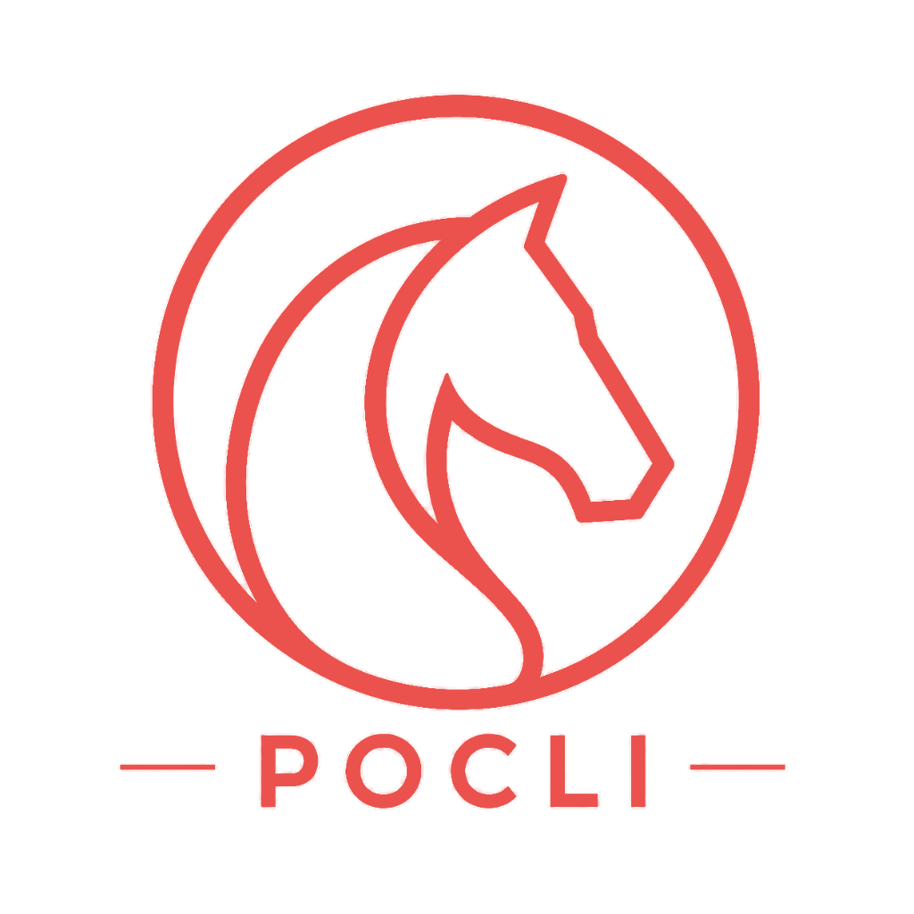
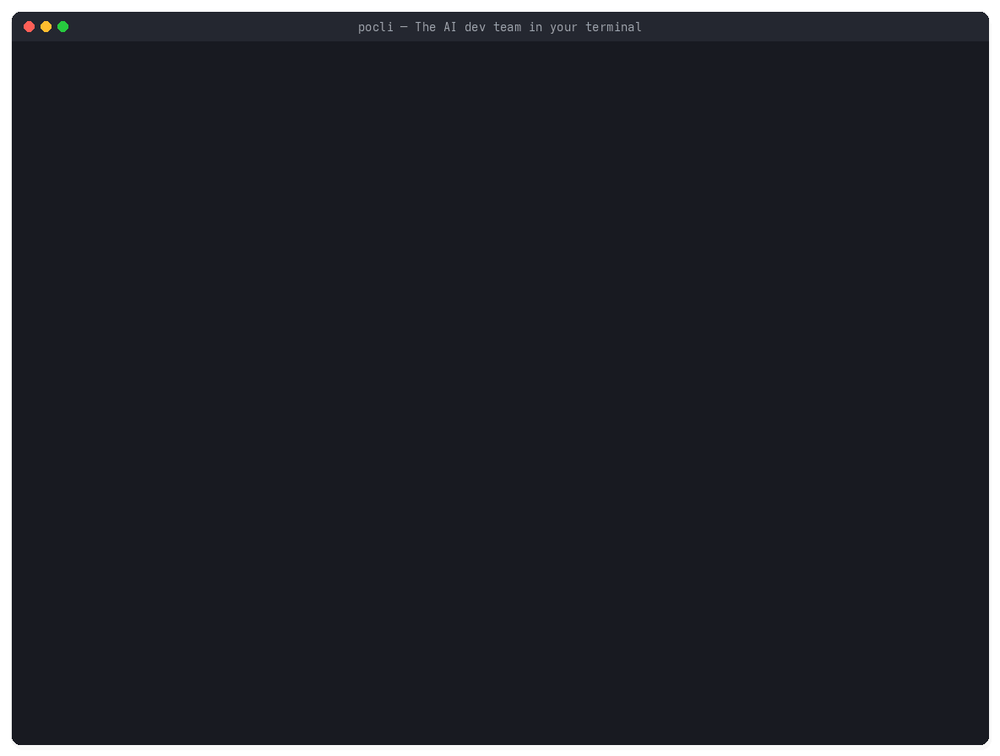

<div style="display: flex; flex-wrap: wrap; align-items: center; gap: 1.5rem; margin: 1rem 0 1.75rem; padding: 1.25rem 1.5rem; border: 1px solid #e5e7eb; border-left: 4px solid #e5261f; border-radius: 8px; background: #fff9fa;">
  
  <div style="flex: 1 1 320px;">
    <p style="margin: 0 0 0.5rem; font-size: 1.05rem; font-weight: 700; color: #1f2937;">
      Define the intent. Direct the agents. Deliver verified software.
    </p>
    <p style="margin: 0 0 0.85rem; color: #4b5563;">
      An open-source, Linux-native terminal environment (TUI &amp; CLI) where <strong>you act as the Product Owner</strong> at the helm of a governed multi-agent engineering team.
    </p>
    <div style="display: flex; flex-wrap: wrap; gap: 0.6rem;">
      <a class="btn btn--primary btn--small" href="https://artificial-intelligence-engineering.github.io/pocli-website/" target="_blank" rel="noopener noreferrer">Official Website (EN)</a>
      <a class="btn btn--info btn--small" href="https://artificial-intelligence-engineering.github.io/pocli-website/es/" target="_blank" rel="noopener noreferrer">Sitio Web (ES)</a>
      <a class="btn btn--inverse btn--small" href="https://github.com/artificial-intelligence-engineering/pocli" target="_blank" rel="noopener noreferrer">GitHub Repository</a>
    </div>
  </div>
</div>

## From Theory to Real Practice: Learning AI Engineering

Everything documented across **AI Engineering** — from [Harness Engineering](/harness/), [Agent Loops](/agent-loop/), and [Spec-Driven Development](/spec-driven-dev/) to [Model Routing](/opencode/), [AI Infrastructure](/ai-infrastructure/), and [AI Product Governance](/ai-governance/) — is actively materializing inside **[POCLI](https://artificial-intelligence-engineering.github.io/pocli-website/)**.

Rather than keeping these concepts as isolated notes or toy scripts, POCLI serves as a **real, modern engineering codebase and hands-on learning platform** where every architectural pattern of modern AI systems is implemented end-to-end:

- **Application Development**: Spec-driven workflows with traceable normative bundles (`REQ`, `ADR`, `ARCH`, `SPEC`) and Product Owner human-in-the-loop gates.
- **Model Development & Routing**: Multi-provider gateway (`OpenRouter`, `Groq`, `Cerebras`, `Gemini`, `Ollama`, `OpenCode Zen`, `Anthropic`, `OpenAI`) with sliding-window quotas, Bandit presets, and automatic failover.
- **AI Infrastructure**: Minimal token-efficient harness, SQLite WAL persistence, 3-tier context window assembly, 4-layer memory, lossless compaction (`/compact`), and local Hybrid RAG (`SHA-256` + `FTS5` + vector similarity).
- **AI Governance**: Deterministic 8-phase SDLC state machine (`AuthorityGuard`), single-writer database coordinator (`PoCliCoordinator`), Linux Bubblewrap (`bwrap`) / Podman OCI process isolation, and independent verification gates.

## Terminal Command Center in Action

The walkthrough below runs the real Ink TUI (`CommandCenterApp`): creating a project (`/project`), assigning models to all agents (`/models all`), collaborating with the Software Architect, running autonomous `ARQ → DEV → QA → ARQ` execution and verification, cycling agent channels (`Ctrl+N`), inspecting the 4-panel Multi-View Command Center (`Tab`), and generating an executive HTML status report (`/agents pm`).

<div style="margin: 1.25rem 0 1.75rem; text-align: center;">
  
</div>

## The Virtual Engineering Team

Each specialist runs inside an isolated Linux OS worker process over JSON-RPC 2.0 `stdio` with strict role-bounded tools (`allowedTools`) and zero cross-conversation context bloat:

| Role | Responsibility | Key Outputs & Verification |
| --- | --- | --- |
| **Product Owner (You)** | Defines product intent, reviews specs, and approves gates | `/project`, `/models`, `/approve`, `/accept` |
| **Software Architect** | Translates intent into requirements, ADRs, architecture, and technical specs | `REQ-*`, `ADR-*`, `ARCH-001`, `SPEC-001`, `[ARQ → DEV]` |
| **Senior Developer** | Implements software, writes unit tests and Gherkin contracts inside workspace | `repos/`, `CODE-001`, `DEV-GHERKIN-001.feature`, `[DEV → QA]` |
| **Independent QA Engineer** | Provisions isolated `.venv`, executes Robot Framework & Mutation Testing | `QA-001`, `TC-MUT-001`, bidirectional `[QA → DEV]` loop |
| **Project Manager (PM)** | Queries across roles and compiles full executive HTML delivery reports | `PM-001`, `deliveries/project-status-report.html` |

## Key Engineering Highlights

| Capability | How POCLI Implements It | Reference on This Site |
| --- | --- | --- |
| **Minimal Harness & Loop** | JSON-RPC worker loop with `agent.streamChunk` TUI streaming and `MAX_QA_CORRECTION_CYCLES = 3` | [Harness Engineering](/harness/) · [Agent Loop](/agent-loop/) |
| **Context & Memory Engine** | 3-Tier Context Window + 4-Layer Memory + lossless `/compact` checkpoints in SQLite (`context_compactions`) | [AI Agent](/ai-agent/) |
| **Local Hybrid RAG** | `NotebookRagEngine` with incremental `SHA-256` change tracking, SQLite `FTS5`, and vector retrieval | [AI Infrastructure](/ai-infrastructure/) |
| **Governance & Isolation** | `AuthorityGuard` SDLC state enforcement, `PoCliCoordinator` sole write owner, `bwrap` / `podman` sandboxing | [AI Governance](/ai-governance/) |
| **Headless E2E & Standards** | Built-in `McpRegistry` (JSON-RPC `stdio` MCP client), `pocli db` SQL REPL, `pocli e2e`, and `pocli tui-test` | [Tools](/tools/) · [OpenCode](/opencode/) |

## Quick Start (Linux)

Install POCLI in one command (Node.js >= 22.5 LTS):

```sh
curl -fsSL https://artificial-intelligence-engineering.github.io/pocli/install.sh | sh
```

To explore the complete documentation, interactive **AI Agent Harness Reference Matrix**, and bilingual guide:

- **Full Project Website (EN)**: [artificial-intelligence-engineering.github.io/pocli-website](https://artificial-intelligence-engineering.github.io/pocli-website/)
- **AI Harness Reference Matrix**: [POCLI Capabilities & Coverage Matrix](https://artificial-intelligence-engineering.github.io/pocli-website/services/#harness-matrix)
- **Guía completa en Español**: [artificial-intelligence-engineering.github.io/pocli-website/es](https://artificial-intelligence-engineering.github.io/pocli-website/es/)
- **Source Code & Releases**: [github.com/artificial-intelligence-engineering/pocli](https://github.com/artificial-intelligence-engineering/pocli)

